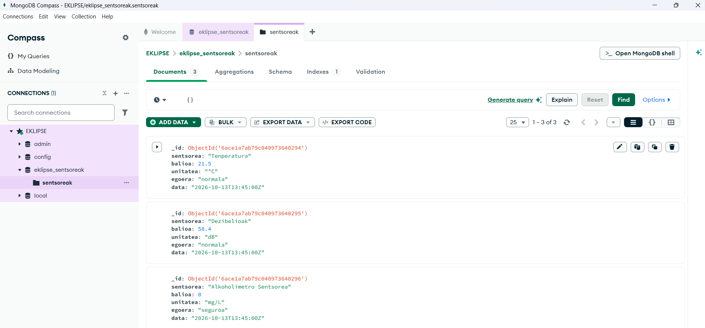
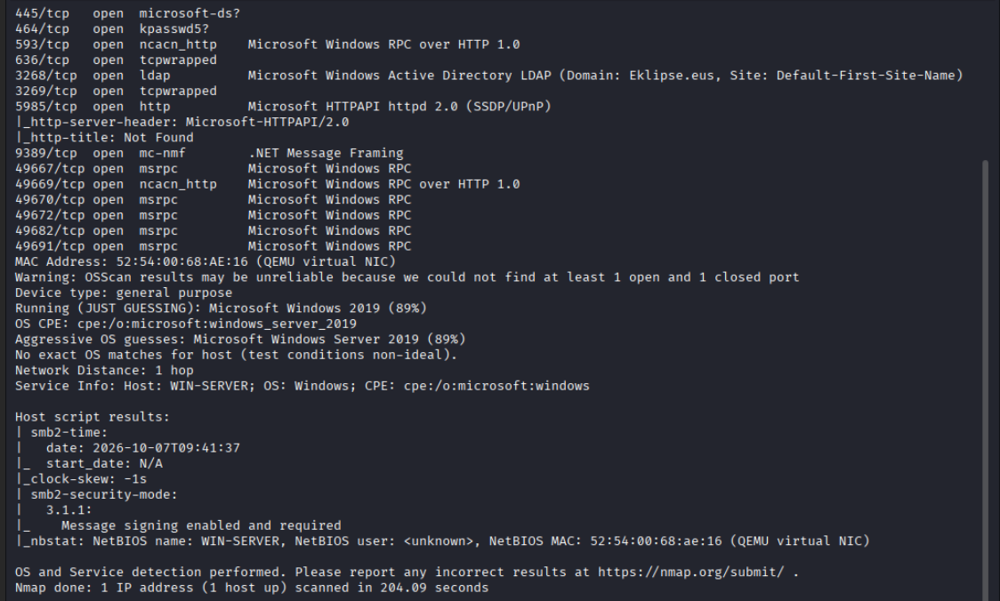
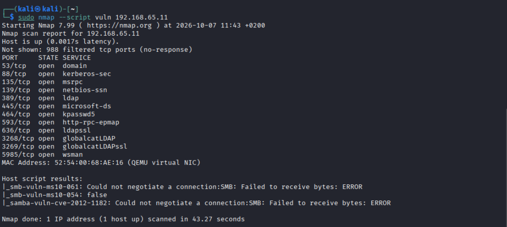
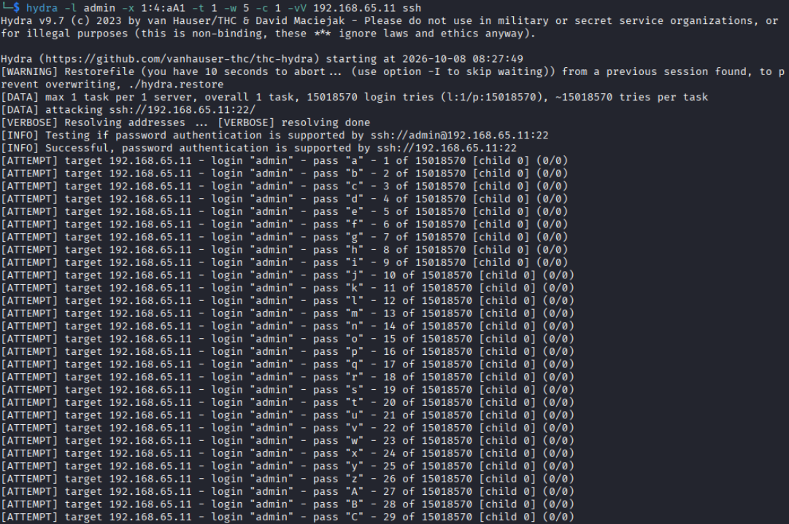
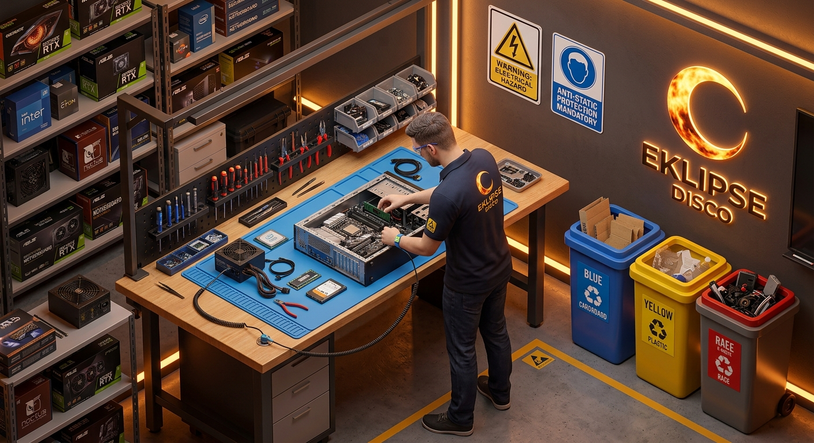

# T - 5 - EKLIPSE — DOKUMENTAZIOA

Proiektu honetako dokumentazio teknikoa, ekonomikoa eta jasangarritasunekoa biltzen du README honek. Jatorrizko dokumentuak (Google Drive) hona kopiatu dira, formatua mantenduz.

## Aurkibidea

1. [Datu-Baseen Estrategia eta Arkitektura](#1-datu-baseen-estrategia-eta-arkitektura---diskoteka)
2. [Datu Baseak - DOKUMENTUA](#2-datu-baseak---dokumentua)
3. [Ziber eta segurtasuna](#3-ziber-eta-segurtasuna)
4. [EKLIPSE DISCO aretoetarako proposamen tekniko, ekonomiko eta orokorra](#4-eklipse-disco-aretoetarako-proposamen-tekniko-ekonomiko-eta-orokorra)
5. [Jasangarritasun Plana](#5-jasangarritasun-plana)

---

## 1. Datu-Baseen Estrategia eta Arkitektura - Diskoteka

### 1. Datu Bilketa eta Sarrera

Proiektu/erronka honetan, informazioa biltzeko estrategia hibrido bat ezarri da, datuen izaera eta sorkuntza-abiaduraren arabera banatuta:

#### 1.1. Denbora Errealeko Sarrera (IoT eta Lokalaren Monitorizazioa)

Nahi diren neurriak etengabe jasotzen dira establezimendutik barrena dauden sentsore eta sistema banatuen bidez, segurtasuna, erosotasuna eta kudeaketa operatiboa optimizatzeko:

- **Ingurumen-sentsoreak:** Tenperatura eta hezetasun sentsoreak, aretoetako klimatizazioa uneko afororaren arabera erregulatzeko.
- **Alkohol kontsumoaren eta tabernaren telemetria:** Emari-neurgailuak eta banagailu adimendunak, zerbitzatutako alkohol bolumena eta portzentajea automatikoki zenbatze aldera.
- **Aforoaren eta soinu-mailaren kontrola:** Pertsonen sarrera-irteerak zenbatzeko sentsore optikoak eta soinu-maila (dezibelioak - dB) neurtzeko sentsoreak, araudia betetzen dela bermatzeko.
- **Energia-kontsumoa:** Argiztapen eta soinu ekipamenduen elektrizitate-gaitasuna denbora errealean monitorizatzea.

#### 1.2. Harrera Zerbitzua eta Bezeroen Kudeaketa

Sarreran edo erregistro komertzialean jasotzen diren datuak:

- **Sarrera orokorra:** Adina egiaztatzea eta esparrura sartzeen oinarrizko erregistroa.
- **Fidelizazio programa (Bazkideak):** Datu pertsonal aurreratuen erregistroa (izena, abizenak, posta elektronikoa, telefonoa, jaiotze-data), profilen kudeaketarako, sustapenetarako eta lehentasunezko sarbiderako.

#### 1.3. Logistika eta Eragiketa Datuak (Stock-a eta Salmentak)

Inbentarioaren eta merkataritza-transakzioen fluxua kontrolatzea:

- **Produktuen trazabilitatea:** Botilen irekieren erregistroa, eta barra-kodeen edo RFID irakurketak stock-a berritzerakoan.
- **Salmenta puntuak (TPV):** Tabernetan egindako salmentak, VIP mahaien erreserbak eta biltegi bakoitzean geratzen den stock-a denbora errealean.

### 2. Erresilientzia, Erabilgarritasuna eta Erabilgarritasun Handia (HA)

Ezintasun teknikoen edo hardware akatsen aurrean datu-baseak funtzionatzen jarraituko duela bermatzeko, Denbora Errealeko Replikazio Aktibo/Pasiboko eskema bat ezarri da:

| **Osagaia** | **Rola Arkitekturan** | **Sinkronizazio Mekanismoa** |
| --- | --- | --- |
| **Nodul Nagusia (Primary/Master)** | Idazketak eta irakurketak jasotzen ditu denbora errealean. | Transakzio-logen etengabeko sinkronizazioa. |
| **Bigarren Mailako Nodulua (Secondary/Replica)** | Nagusiaren kopia berdina itxaronaldi aktiboan. Nagusiak huts eginez gero zerbitzua hartzen du. | Sinkronizazio sinkrono edo asinkronoa denbora errealean. |

- **Failover Estrategia (Akatsen aurreko tolerantzia):** Datu-base nagusiak huts eginez gero, sistemak automatikoki bigarren mailako nodulura aldatzen du zerbitzua, daturik galdu gabe eta salmenta zein sarbide prozesuak gelditu gabe.
- **Segurtasun-copien Politikak (Backup):** Eguneroko kopia automatiko metagarriak, lan-ordutegitik kanpo programatuta.

### 3. Justifikazio Teknikoa eta Sistemaren Monitorizazioa

#### 3.1. Datu-Base Motorren Aukeraketa

- **MySQL (Erlazionala / OLTP):** Osotasun zorrotza behar duten transakzio kritikoak egituratzeko (bazkideen datu pertsonalak, fakturazioa, TPV eta logistika inbentarioa).
- **MongoDB (NoSQL / Dokumentala / Denbora Seriakoak):** IoT sentsoreetatik datorren abiadura handiko fluxua jasotzeko (tenperatura, aforoa, dezibelioak), bere eskema malgutasunagatik.

#### 3.2. Egoera Egiaztatzea Terminal Bidez eta Konfigurazio Fitxategiak

Datu-baseen funtzionamendu egokia egiaztatzeko, log-ak aztertzeko eta klusterraren zein replikazioaren konfigurazioa berrikusteko, prozedura hauek erabiltzen dira komando-kontsolatik:

**MySQL Berrikuspena**

Konfigurazio fitxategi nagusia: `/etc/mysql/mysql.conf.d/mysqld.cnf`

```bash
sudo systemctl status mysql
tail -f /var/log/mysql/error.log

mysql -u admin -p
SHOW MASTER STATUS;
SHOW SLAVE STATUS\G
```

**MongoDB Berrikuspena**

Konfigurazio fitxategi nagusia: `/etc/mongod.conf`

```bash
sudo systemctl status mongod
tail -f /var/log/mongodb/mongod.log

mongosh
rs.status()
```

---

## 2. Datu Baseak

`[Bazkideak] ───< [VIP Erreserbak] ───< [Sarrerak] │ [Produktuak / Inbentarioa] ──< [Salmenta Enpt.] ───< [Salmentak] │ │ [Stock Mugimenduak] [TPV Terminalak]`

Datu-base hau Hirugarren Forma Normalari (3NF) jarraituz diseinatu dugu, diskotekaren eguneroko jarduera kaotikoan datuak ez bikoizteko, eragiketak azkartzeko eta informazioaren osotasuna bermatzeko. Aplikazioa lau modulu nagusitan banatu dugu, bakoitzak negozioaren arlo kritiko bati erantzuteko:

- **→Bazkideak** (`bazkideak`): Bezeroen datu pertsonalak segurtasunez eta bakarrean gordetzen ditu (NAN eta posta elektronikoa bikoiztu gabe), sarreren eta VIP erreserben moduluarekin erraz lotzeko baina TPVko salmenta arruntei oztoporik egin gabe.
- **→Logistika eta BEZa** (`produktuak`, `bez_motak`, `stock_mugimenduak`): Inbentarioaren eta barretan banatutako alkoholaren trazabilitatea zehatz mehatz mantentzen du, galeren eta mermen kontrola erraztuz. BEZ motak bereizita daudenez, aldaketa fiskaletara erraz egokitzen da.
- **→Salmentak eta TPV** (`salmentak`, `salmenta_enptizioak`): Transakzio bakoitzaren burua eta xehetasunak banandu ditugu ticket bakoitzean produktu anitz sartu ahal izateko. Erosketa unean prezioa eta BEZa 'argazki' gisa gordetzen dira, etorkizunean produktuen prezioak aldatuta ere kontabilitate historikoa ukitu gabe geratzeko.
- **→Sarrerak eta VIP** (`ekitaldiak`, `sarrerak`, `vip_erreserbak`): Atean QR bidezko sarbide azkarra eta VIP mahaien erreserbak (gutxieneko kontsumoak eta edukiera) kudeatzen ditu, betiere egindako ordainketa eta fakturazioarekin zuzenean lotuta.

Banaketa modular honi esker, sistemak eraginkortasun altua eskaintzen du, mantentze-lanak errazten ditu eta akats operatibo zein ekonomikoak prebenitzen ditu.

### Taulen Definizioa DDL (SQL)

#### A. Bazkideak eta Fidelizazioa (Bazkideak)

Bazkideen datu pertsonalak kudeatzeko eta euren NAN/DNI zein posta elektronikoa babesteko.

```sql
CREATE TABLE bazkideak (
    bazkide_id INT AUTO_INCREMENT PRIMARY KEY,
    izena VARCHAR(100) NOT NULL,
    abizenak VARCHAR(100) NOT NULL,
    nan_dni VARCHAR(20) UNIQUE NOT NULL,
    helbide_elektronikoa VARCHAR(150) UNIQUE NOT NULL,
    telefono_zenbakia VARCHAR(20),
    jaiotze_data DATE NOT NULL,
    alta_data TIMESTAMP DEFAULT CURRENT_TIMESTAMP,
    aktibo BOOLEAN DEFAULT TRUE
);
```

#### B. Logistika eta Inbentarioa (Inbentarioa / Produktuak)

Tabernan banatutako alkohola eta gainontzeko produktuak kudeatzen ditu, baita BEZ (IVA) mota bakoitza ere.

```sql
-- BEZ Motak (Orokorra %21, Murriztua %10, etab.)
CREATE TABLE bez_motak (
    bez_id INT AUTO_INCREMENT PRIMARY KEY,
    ehunekoa DECIMAL(5,2) NOT NULL, -- Adib. 21.00
    deskribapena VARCHAR(50)
);

-- Produktuen Katalogoa
CREATE TABLE produktuak (
    produktua_id INT AUTO_INCREMENT PRIMARY KEY,
    izena VARCHAR(100) NOT NULL,
    kategoria ENUM('Alkohola', 'Freskagarria', 'Janaria', 'Merchandising', 'Beste bat') NOT NULL,
    oinarrizko_prezioa DECIMAL(10,2) NOT NULL, -- Prezioa BEZ gabe
    bez_id INT NOT NULL,
    uneko_stocka INT DEFAULT 0,
    gutxieneko_stocka INT DEFAULT 10,
    FOREIGN KEY (bez_id) REFERENCES bez_motak(bez_id)
);

-- Inbentario Mugimenduak (Biltegitik tabernako txosna/barra ezberdinetara)
CREATE TABLE stock_mugimenduak (
    mugimendua_id INT AUTO_INCREMENT PRIMARY KEY,
    produktua_id INT NOT NULL,
    mota ENUM('Hornitzaile_Sarrera', 'Barra_Banaketa', 'Hondatzea_Haustura', 'Doitzea') NOT NULL,
    kantitatea INT NOT NULL,
    jatorri_kokapena VARCHAR(50), -- Adib. 'Biltegi_Nagusia'
    helburu_kokapena VARCHAR(50), -- Adib. 'Barra_1'
    data TIMESTAMP DEFAULT CURRENT_TIMESTAMP,
    FOREIGN KEY (produktua_id) REFERENCES produktuak(produktua_id)
);
```

#### C. Salmentak eta TPV (Salmentak)

TPV bidez egindako transakzio guztiak, ordainketa motak eta BEZaren banaketa gordetzen ditu.

```sql
-- TPV Puntuak / Barrak
CREATE TABLE tpv_terminalak (
    tpv_id INT AUTO_INCREMENT PRIMARY KEY,
    barra_izena VARCHAR(50) NOT NULL, -- Adib. 'Barra Nagusia', 'VIP Barra'
    kokapena VARCHAR(50)
);

CREATE TABLE salmentak (
    salmenta_id INT AUTO_INCREMENT PRIMARY KEY,
    tpv_id INT NOT NULL,
    bazkide_id INT NULL, -- Aukerakoa, eroslea bazkidea bada
    salmenta_data TIMESTAMP DEFAULT CURRENT_TIMESTAMP,
    oinarri_zergapea DECIMAL(10,2) NOT NULL, -- BEZ gabe
    bez_totala DECIMAL(10,2) NOT NULL,
    prezio_totala DECIMAL(10,2) NOT NULL,
    ordainketa_mota ENUM('Eskudirutan', 'Txartela', 'Bizum', 'Mistoa') NOT NULL,
    FOREIGN KEY (tpv_id) REFERENCES tpv_terminalak(tpv_id),
    FOREIGN KEY (bazkide_id) REFERENCES bazkideak(bazkide_id)
);

-- Salmenten Xehetasunak (Produktuz produktu)
CREATE TABLE salmenta_enptizioak (
    enptizio_id INT AUTO_INCREMENT PRIMARY KEY,
    salmenta_id INT NOT NULL,
    produktua_id INT NOT NULL,
    kantitatea INT NOT NULL,
    unitate_prezioa_oinarria DECIMAL(10,2) NOT NULL,
    bez_ehunekoa DECIMAL(5,2) NOT NULL,
    azpitotala DECIMAL(10,2) NOT NULL,
    FOREIGN KEY (salmenta_id) REFERENCES salmentak(salmenta_id),
    FOREIGN KEY (produktua_id) REFERENCES produktuak(produktua_id)
);
```

#### D. Sarrerak eta VIP Erreserbak (Sarrerak / Erreserbak)

Ekitaldi bakoitzeko sarreren salmenta eta VIP guneen erreserbak kudeatzen ditu.

```sql
-- Ekitaldiak / Saioak
CREATE TABLE ekitaldiak (
    ekitaldi_id INT AUTO_INCREMENT PRIMARY KEY,
    izena VARCHAR(100) NOT NULL,
    ekitaldi_data DATETIME NOT NULL,
    edukiera_maximoa INT NOT NULL
);

-- VIP Erreserbak
CREATE TABLE vip_erreserbak (
    erreserba_id INT AUTO_INCREMENT PRIMARY KEY,
    ekitaldi_id INT NOT NULL,
    bazkide_id INT NULL,
    bezero_izena VARCHAR(100) NOT NULL,
    kontaktuko_telefonoa VARCHAR(20) NOT NULL,
    vip_eremua VARCHAR(20) NOT NULL, -- Adib. 'Mahai_04'
    baimendutako_pertsonak INT NOT NULL,
    gutxieneko_kontsumoa DECIMAL(10,2) DEFAULT 0.00,
    erreserba_prezioa DECIMAL(10,2) NOT NULL,
    egoera ENUM('Zain', 'Baieztatua', 'Ezeztatua', 'Osatua') DEFAULT 'Zain',
    FOREIGN KEY (ekitaldi_id) REFERENCES ekitaldiak(ekitaldi_id),
    FOREIGN KEY (bazkide_id) REFERENCES bazkideak(bazkide_id)
);

-- Igorritako Sarrerak
CREATE TABLE sarrerak (
    sarrera_id INT AUTO_INCREMENT PRIMARY KEY,
    ekitaldi_id INT NOT NULL,
    salmenta_id INT NOT NULL, -- Salmenta-ordainketarekin lotura
    erreserba_id INT NULL,   -- VIP erreserba bati badagokio
    qr_kodea VARCHAR(255) UNIQUE NOT NULL,
    sarrera_mota ENUM('Arrunta', 'VIP', 'Aurretiarra', 'Zerrenda') NOT NULL,
    kontsumizioa_barne BOOLEAN DEFAULT TRUE,
    Sarrera_egoera ENUM('Erabili_gabea', 'Sartuta', 'Ezeztatua') DEFAULT 'Erabili_gabea',
    sarrera_data DATETIME NULL,
    FOREIGN KEY (ekitaldi_id) REFERENCES ekitaldiak(ekitaldi_id),
    FOREIGN KEY (salmenta_id) REFERENCES salmentak(salmenta_id),
    FOREIGN KEY (erreserba_id) REFERENCES vip_erreserbak(erreserba_id)
);
```

### Diseinuaren Punturik Garrantzitsuenak

- **BEZ eta Zerga Kontrola** (`bez_motak` / `salmentak`): Salmenta bakoitzean `oinarri_zergapea`, `bez_totala` eta `prezio_totala` bereizten dira kontabilitate garbia izateko. `salmenta_enptizioak` taulan erosketaren unean aplikatutako BEZ ehunekoa gordetzen da, etorkizunean zerga-tasak aldatuko balira ere historikoak zuzen jarrai dezan.
- **Stockaren Mugimenduak** (`stock_mugimenduak`): Biltegi nagusitik zein barramendutara aldatzen den alkohola zehatz mehatz trazatzea ahalbidetzen du, galerak edo hausturak kontrolatuz.
- **VIP Erreserbak eta Sarrerak** (`sarrerak` / `vip_erreserbak`): `qr_kodea` erabiliz sarrerak atean eskaneatzeko prest uzten du eta VIP mahaien kudeaketa bazkideak taulari lotuta egotea bermatzen du.

### Erabiltzaile eta portuen justifikazioa - zergatik?

Datu-basearen segurtasuna eta kudeaketa egokia bermatzeko, zerbitzua atzitzeko portu zehatzak eta baimen desberdintasunak dituzten erabiltzaileak definituko dira. Alde batetik, datu-basearen zerbitzariak **3306 portu estandarra** erabiliko du (MySQL/MariaDB) barne-sareko komunikaziorako, eta aplikazio-zerbitzariarekin edo TPV terminalekin konexio segurua izateko 443 portua (HTTPS) gaituko da API bidezko atzipenetarako.

Bestetik, erabiltzaile-rol desberdinak sortuko dira gutxieneko pribilegioen printzipioari jarraituz:

- `admin_diskoteka`: zerbitzuaren kudeatzaile nagusia, egitura aldatzeko eta segurtasun-copiak egiteko baimen osoekin.
- `tpv_langilea`: barrako terminaletan salmentak erregistratzeko eta stocka kontsultatzeko DML baimen mugatuekin.
- `atezaina_sarrerak`: atean QR kodeak egiaztatzeko eta sarrera-egoera eguneratzeko baimen soilarekin.
- `kudeatzailea_logistika`: biltegiko mugimenduak, alkohola eta inbentarioa kudeatzeko baimen espezifikoekin.

### MongoDB Instalazioa eta Konfigurazioa: EKLIPSE Proiektua

Dokumentu honetan EKLIPSE proiekturako MongoDB datu-basearen instalazio, konfigurazio eta datu-sarrera prozesu osoa azaldu eta dokumentatzen da.

**1. MongoDB Server eta MongoDB Compass Instalazioa**

Datuak tokian bertan (local) gordetzeko eta kudeatzeko, software hauek deskargatu eta instalatu dira:

- MongoDB Community Server (v9.0.2): Datu-basearen zerbitzari nagusia. Windows-erako .msi instalatzaile ofizialaren bidez deskargatu da.
- MongoDB Compass: Datu-basea modu bisual batean kudeatzeko interfaze grafikoa (GUI).

Instalazio urratsak Windows-en:

1. MongoDB Community Server instalatzailea (.msi) exekutatu da.
2. Konfigurazioan "Install MongoDB as a Service" eta "Run service as Network Service user" aukerak hautatuta utzi dira zerbitzaria atzealdean automatikoki abiarazteko.
3. Aukerazko MongoDB Compass tresna instalatzea onartu da.

**2. Zerbitzarira Konekzioa**

Instalazioa amaitutakoan, MongoDB Compass tresna ireki eta tokiko zerbitzarira konektatu da hurrengo URI konexio-katea erabiliz:

```
mongodb://localhost:27017
```

**3. Datu-basea eta Bilduma (Collection) Sortzea**

Proiektuko sentsoreen datuak egituratzeko, datu-base bat eta bilduma bat sortu dira:

- **Datu-basea (Database):** `eklipse_sentsoreak` — EKLIPSE proiektuko sentsore guztien informazioa biltzeko datu-base nagusia.
- **Bilduma (Collection):** `sentsoreak` — Sentsore ezberdinen neurketak gorde eta egituratzen dituen bilduma.

**4. Sentsoreen Datuak Txertatzea (JSON)**

Proiektuak hiru sentsore nagusi ditu: Tenperatura, Dezibelioak eta Alkoholimetro Sentsorea. Datuak modu egokian gordetzeko, egituratutako JSON dokumentuak txertatu dira `sentsoreak` bilduman:

```json
[
  { "sentsorea": "Tenperatura", "balioa": 21.5, "unitatea": "ºC", "egoera": "normala", "data": "2026-10-13T13:45:00Z" },
  { "sentsorea": "Dezibelioak", "balioa": 58.4, "unitatea": "dB", "egoera": "normala", "data": "2026-10-13T13:45:00Z" },
  { "sentsorea": "Alkoholimetro Sentsorea", "balioa": 0.0, "unitatea": "mg/L", "egoera": "seguroa", "data": "2026-10-13T13:45:00Z" }
]
```

**5. Azken Emaitza eta Egiaztapena**

Datuak ondo txertatu ondoren, MongoDB Compass-eko bildumaren panelean hiru dokumentuak agertzen dira beren eremu eta balio guztiekin, proiekturako erabilgarri eta prest.



---

## 3. Ziber eta segurtasuna

### Informazio publikoaren bilakaera

Windows serverraren komprobapen orokor bat egin da, IP mapa bat sortzeko. IPak lortu dira, baina windows normala ezin izan da aurkitu.

### Zerbitzu edo aplikazio aktiboen eskaneoa

Ikusi izan dugu zein zerbitzu dauden aktibo momentuan, eta hauek non dauden ipinita. Honen ezker ere ikusa da kali linux esaten "segurunez windows 2019 erabiltzen hari da".



### Ahultasun edo hedapen bilaketa

Windows Serverrean egin da saiakera eta ikusi da tcp irekiak eta ahultasunak. Pasahitza ezin izan da lortu, hydra motelegia delako.





### Ahultasun ustiaketa

Ezin izan da zerbitzuetan sartu, loginaren faltagatik, bakarrik admin usuarioa asmatu. Hala ere, behar den denbora duen batematek edo sistema azkarrago bat lortu eta erabiltzen duen norbaitek sartzeko aukera izango zuen windows serverrean, eta hori problema handia izan dezake.

Ahultasunak aurkitu dira logina margin asko utzi duelako, netmapa oso irekia eta aztertzeko erraza delako eta ip-ak argira daude. Arazo hauek ez izateko, login sahiakera limite bat ipini beharko da, eta firewall-a edo routerra configuratu netmap eta ip-ak bistan ez izateko.

### Segurtasuna

#### 1. Agertoki bakoitzeko erantzun-plan zehatzak

| **Agertokia** | **Arrazoia / Abiarazlea** | **1. Urratsa: Berehalako erreakzioa (0–15 s)** | **2. Urratsa: Kontrola eta arintzea (1–5 min)** | **3. Urratsa: Berrabiaraztea eta normalizazioa** | **Arduradun zuzena** |
| --- | --- | --- | --- | --- | --- |
| **A. Konektibitate edo sare-akatsa** | Latentzia > 2.000 ms, pakete-galera > % 15 edo zuntz optiko nagusiaren erorketa. | Tokiko bukle grafiko erreaktibora aldatze automatikoa. DJak musikaren erritmoa igotzen du. | Sarearen komutazioa ordezko 5G bideratzailera (routerra). Bigarren mailako ISParekin diagnostikoa egitea. | Seinalea berriro konektatzea latentzia < 100 ms denean eta transferentzia-tasa egonkorra denean. | AV Teknikaria / VJ |
| **B. Eduki zakarra edo legez kanpokoa** | Biluztasuna, istiluak, legez kanpoko kontsumoa edo kamera aurrean portaera ezinokorrak. | "Larridura-botoia" sakatzea. 5 s-ko atzerapen-bufferrak eszena beste hirira iristea eragozten du. | Kortina grafikoa proiektatzea ("Seinalea doitzen..."). Segurtasun-pertsonala eremura bidaltzea. | Inplikatutakoak kanporatzea/ohartaraztea. Emisioa berriro aktibatzea segurtasunak egiaztatu ondoren. | VJ Operadorea / Segurtasuna |
| **C. Ikus-entzunezko hardware-akatsa** | LED pantaila/proiektorea itzaltzea, AV eskalatzailea izoztea edo tokiko kameraren akatsa. | Bideo-irteera tokiko ohiko argiteria-sistemara bideratzea, pantaila nagusirik gabe. | Ordezko ekipoa jartzea edo LED prozesadorea berrabiarazi. | Seinale grafikoa berriro lerrokatzea eta hardwarearen tenperatura/elikadura egiaztatzea. | Guardiako AV Teknikaria |
| **D. Urruneko eboluzioa edo larrialdia** | Interkomunikadoretik abisua edo urruneko pantailan izua/alarmak/sutea ikustea. | Pantailan berehala beltzera igarotzea eta urruneko audio-sarrera guztiz moztea. | Tokiko saioarekin jarraitzea argiteria eta DJ propioarekin, ikusleak kanpoko alarmatik bakartuz. | Urruneko egoitzako zuzendaritzarekin balorazioa egitea saioa berriz aktibatu edo gau horretan bertan behera uztea erabakitzeko. | Eragiketen Zuzendaria / DJ |
| **E. Zibererasoa edo seinalearen hackeoa** | Kanpoko seinalea txertatzea, ikusmen-manipulazioa, ransomware edo DDoS erasoa. | Sareko kablea fisikoki deskonektatu eta tokiko konexiorik gabeko (offline) seinalera pasatzea. | Emisio-kredentzialak/gakoak (SRT/RTMP) berehala aldatzea eta VLAN seguru batean bakartzea. | Bi faktoreko autentifikazioa (2FA) duen ordezko zerbitzari enkriptatura migratzea. | IT Teknikaria / VJ Operadorea |

#### 2. Agertoki bakoitzari lotutako beharrezko baliabideen matrizea

| **Baliabidea / Tresna** | **Mota** | **Zein agertokitan aplikatzen den** | **Funtzio espezifikoa agertokiaren arabera** |
| --- | --- | --- | --- |
| **Failover 5G duen Dual-WAN bideratzailea** | Sarea | A agertokia, E agertokia | A-n, trafikoa 5G sarera igortzen du zuntzak huts egin ondoren. E-n, garbi bakartutako sare batetik irten ahal izatea ahalbidetzen du. |
| **Atzerapen-buffer prozesadorea + Larridura-botoia** | AV Hardwarea | B agertokia, E agertokia | B-n, egokiak ez diren irudiak blokeatzen ditu 5 s-ko marjinarekin. E-n, konprometitutako seinalea eskuz mozten du. |
| **Ordezko AV Ekipoak (Kamera / Kodetzailea)** | AV Hardwarea | C agertokia | Osagai elektroniko nagusiek huts eginez gero, ordezkatze azkarra. |
| **Lineaz kanpoko edukien zerbitzaria (B Plana)** | Softwarea / PCa | A, B, C, D, E agertokiak | Ikusmen-bukleak eta animazioak sortzen ditu SSD unitatean, kanpoko konexiorik edo urruneko hardwarerik behar izan gabe. |
| **Firewall industriala VPN / SRT enkriptatzearekin** | Zibersegurtasuna | E agertokia | Baimenik gabeko sarbideak eta DDoS erasoak blokeatzen ditu, eta hiri arteko bideo-tunela enkriptatzen du (AES-128). |
| **IP Dedikatuko Interkomunikadorea / Comlink** | Komunikazioak | D agertokia, E agertokia | Zuzendarien arteko ahots-kanal pribatu eta etenik gabea mantentzen du gertakari larriak edo hackeoak egiaztatzeko. |
| **SAI / UPS Sistema (3 kVA)** | Energia | A, B, C, D, E agertokiak | AV/IT rack-a babesten du mikromozketen edo tentsio-jaitsieren aurrean, hardwarea kaltetzea saihestuz. |
| **Kabinako AV / VJ Operadorea** | Pertsonala | A, B, C, D, E agertokiak | Komutazioak burutzen ditu, larridura-botoia sakatzen du eta berehalako ikusmen-erantzuna kudeatzen du. |
| **Kamera eremuko Segurtasun-agentea** | Pertsonala | B agertokia | Kameraren eremuan ikusleen portaera moderatzen du eta istiluen aurrean esku hartzen du. |
| **Guardiako IT Espezialista / Laguntza** | Pertsonala | A agertokia, C agertokia, E agertokia | Sare-arazoak ebazten ditu A-n, elektronika-akatsak C-n eta informazio-sartzeak E-n. |

#### 3. Kontingentzia-aurrekontuaren estimazio osoa

| **Kontzeptua** | **Kategoria** | **Deskribapen teknikoa** | **Estimatutako kostua (€)** |
| --- | --- | --- | --- |
| **Dual-WAN bideratzailea + 5G Modulu Industriala** | CAPEX (Inbertsioa) | Trafikoaren konmutazio automatikoa < 1 s-tan egiten duen sare-sistema. | 1.200 - 1.800 € |
| **Atzerapen-buffer prozesadorea + Etengailua** | CAPEX (Inbertsioa) | HD/4K seinalearen atzerapenerako eta mozketa fisikorako botoia duen hardwarea. | 1.500 - 2.500 € |
| **Ordezko AV Hardwarea (Kamera + Kodetzailea)** | CAPEX (Inbertsioa) | Bigarren mailako HD kamera eta ordezkatze azkarrerako prest dagoen komutatzaile/kodetzailea. | 800 - 1.500 € |
| **Zibersegurtasun Firewall-a + VPN/SRT Lizentzia** | CAPEX (Inbertsioa) | Zibererasoen aurkako babesa, IP iragazketa eta puntuz puntuko enkriptatzea. | 1.000 - 2.000 € |
| **3 kVA-ko SAI/UPS Sistema AV/IT Rack-erako** | CAPEX (Inbertsioa) | Saretarako, prozesamendurako eta bideorako elektronikarako energia-babesa. | 800 - 1.200 € |
| **Redundante den linea + SIM 5G M2M** | OPEX (Hilero) | IP finkodun ISP sekundario independentea + datu mugikor nemagabeak. | 180 - 300 € / hilabete |
| **AV/IT Guardiako teknikari espezializatua** | OPEX (Hilero) | Sare, hardware eta zibersegurtasun laguntzarako urruneko/aurrez aurreko estaldura. | 200 - 400 € / hilabete |

### Pasahitzen politika

Pasahitz guztiak izan beharko dute gutxienez 12 karakter, letra handi eta txiki bat, zenbaki bat eta bestelako seinu bat, eta ez dira bi pasahitz berdin egongo empresa barruan segurtasuna sihurtatzeko. Horrela ba, pentsatutako pasahitzak honako hauek dira:

- `M00nD4nc3r1_` (Donostiko bezerorako Admin)
- `M00nD4nc3r2#` (Bilboko bezerorako Admin)
- `5unW4tch3r0_` (Kali Linuxerako)
- `V13wM4n4g3r#` (Windows Server)
- `S4f3lyL00k5_` (Linux Server)

  

### Sarbide fisikoen eta ingurumenaren politika

Ingurumen problemak kontuan artzeko, serbidoreak eta ordenagailuak gela txukun eta aparteko batean ipiniko dira, eta beraientzat behar diren aire girotuak ipiniko dira hauek tenperatura egokian mantentzeko. Serbidore hauek goiko solairu batean izango dira, eta inoiz direktoki lurrean, urarengatik eta uholdetik babesteko.

Sarbide fisikoak mendean izateko, serbidore edo lan-lekura sartzeko pasahitz bat ipiniko beharko da ikusteko erraza ez den leku batean, hau da, eskailerak igo besain laster edo argi asko eltzen ez den leku bat, horrela pasahitza ez da ikusiko edonorgatik. Gainera, langile bakoitzak bere sarbidea izango du, bere pasahitzarekin. Langileak beren pasahitza aukeratuko dute, baina beti pasahitz politika jarraituz.

### IDS planteamendua

NIDS bat erabiltzea da daukagun aukera bakarra, bi diskoteka konektatuta izan nahi badugu sarera, problemak sarean izango ditugu (DDoS edo Man In the middle), eta ez ordenagailu edo sistema barruan (HIDS erabili behar genuen kasua). NIDSa portu ispilu batean ipini beharko zen Switch-aren barruan, eta anomalia eta firma bidez blockeatzeko ipini behar da. Gure kasuarentzat, Suricata erabiltzea hobeena dela erabaki da.

### LAN edo WAN, DMZ eta VPN

Gure zerbitzuarentzat, behar da WAN sarea erabiltzea, LAN ez duelako beste hiri batera elduko inoiz. DMZa kanpo internetaren eta barruko sareen artean ipinko zen, routerra heldu baino lehen, non VPN ezarriko zen internetera heldu baino lehen, IPak beti seguru izateko.

### Firewall

Firewall bezala, pfsense erabiltzen ari gara, eta honei ipinitako reglak dira:

- **WAN:** VPNa baimendu bere portuan diskotekak kanpora joan dezatela.
- **WireGuard:** streaming-a baimentzea eta bestelakoa blokeatzea, edonor ez sartzeko.
- **DMZ:** Streaming-ari sarbidea baimendu eta LANa blokeatu, hackerrak DMZtik sartzen badira ez heltzeko edonora.

---

## 4. EKLIPSE DISCO aretoetarako proposamen tekniko, ekonomiko eta orokorra

### Osagai eta Gailuen Aurrekontu Xehatua

Atal honetan gailu-mota bakoitzaren unitateko prezioa, ezaugarri teknikoak eta zergatia zehazten dira, eskatutako unitate kopuru berrietara egokituta.

#### 1. Harrera eta Lana Egiteko Potentzia Handiko Portatilak (2 Unitate)

| **Osagaia / Gailua** | **Ezaugarri Teknikoak** | **Unitateko Prezioa (BEZ gabe)** |
| --- | --- | --- |
| **Portatil Potentea** | Intel Core i7-13700H / AMD Ryzen 7 7735HS, 32 GB DDR5 RAM, 1 TB SSD NVMe PCIe 4.0, NVIDIA RTX 4060 8GB, 15.6" IPS Full HD/QHD pantaila | 1.350,00 € |
| **Guztira Portatilak (2 Unitate):** |  | **2.700,00 €** |

**Zergatik hautatzen diren eta nola funtzionatzen duten:**

Portatil hauek harrerako kudeaketa bizkorra eta erreserba-sistema konplexuak atzerapenik gabe exekutatzeko aukera ematen dute. Prozesadore multinukleoak eta 32 GB RAM memoriak aplikazio asko aldi berean irekita izatea bermatzen dute. Txartel grafiko dedikatuak kartelak edo sustapen-bideoak unean bertan editatzeko aukera ematen du. SSD NVMe diskoak sistema operatiboa eta dokumentuak segundotan kargatzen ditu.


#### 2. Pantaila Handiak eta Mini PC Kutsuak/Ezkutatzekoak (2 Unitate)

| **Osagaia / Gailua** | **Ezaugarri Teknikoak** | **Unitateko Prezioa (BEZ gabe)** |
| --- | --- | --- |
| **Mini PC Trinkoa** | VESA euskarria duena (pantaila atzean ezkutatzeko), Intel Core i5-13400 / Ryzen 5 5600H, 16 GB DDR4 RAM, 512 GB SSD NVMe, Wi-Fi 6 + Bluetooth, HDMI 2.1 (4K 60Hz) | 480,00 € |
| **Pantaila Handia** | 65" edo 75" LED/4K UHD Babes-pantaila komertziala (24/7 funtzionamendurako prestatua), HDMI anitzeko sarrerak | 850,00 € |
| **VESA Euskarria eta Kableak** | Hormarako/pantaila atzerako euskarri artikulatua eta HDMI 2.1 kableak | 60,00 € |
| **Guztira Mini PC + Pantaila Pack (Unitate 1):** |  | **1.390,00 €** |
| **Guztira Mini PC + Pantaila Pack (2 Unitate):** |  | **2.780,00 €** |

**Zergatik hautatzen diren eta nola funtzionatzen duten:**

Mini PC-ak ezin hobeto ezkutatzen dira pantailen atzealdean VESA euskarrien bidez, kableak ezkutuan utziz eta estetika garbia mantenduz. HDMI 2.1 bidez 4K rezoluzioko edukia igortzen dute pantaila erraldoietara. Babes-pantaila komertzialak ordu luzez piztuta egoteko eta diskotekako argitasun zein giro-baldintzei aurre egiteko diseinatuta daude.

#### 3. Mahaigaineko PCak eta Periferikoak (12 Unitate)

| **Osagaia / Gailua** | **Ezaugarri Teknikoak** | **Unitateko Prezioa (BEZ gabe)** |
| --- | --- | --- |
| **Prozesadorea (CPU)** | Intel Core i5-13400 / AMD Ryzen 5 5600G | 165,00 € |
| **Placa Ama** | Chipset B760M / B550M iragazki eta babes elektrikoekin | 95,00 € |
| **RAM Memoria** | 16 GB DDR4 3200 MHz (2x8GB) | 45,00 € |
| **Biltegiratzea** | SSD NVMe M.2 500 GB PCIe | 45,00 € |
| **Elikadura Iturria** | 550W 80 Plus Bronze | 55,00 € |
| **Kaxa / Chasis** | Micro-ATX formatua, hautsaren aurkako iragazki integratuekin | 50,00 € |
| **Monitorea** | 24" Full HD IPS 75Hz, altuera erregulagarria | 120,00 € |
| **Periferikoen Pack-a** | Teklatu eta sagu erresistenteak (USB) + Entzungailu mikrofonodunak | 40,00 € |
| **Guztira Mahaigaineko PC Pack (Unitate 1):** |  | **615,00 €** |
| **Subtotal Mahaigaineko PCak (12 Unitate):** |  | **7.380,00 €** |


**Zergatik hautatzen diren eta nola funtzionatzen duten:**

Talde hauek bulegoko lanak, sarreren kudeaketa, barra-kontrola eta barne-komunikazioa bideratzen dituzte. 80 Plus Bronze iturriek babes elektrikoa eskaintzen dute pikoen aurrean, eta kaxetako hauts-iragazkiek osagaien bizitza erabilgarria luzatzen dute. Monitore IPSek ikuspegi angelu zabala eskaintzen dute eta periferiko sendoek erabilera intentsiboa jasaten dute.

### Aurrekontu Orokorra eta Finantza Laburpena

Ondorengo taulan EKLIPSE DISCO proiektuaren aurrekontu osoa banatzen da, hardwarea, software lizentziak, lanabesak, lan-eskua eta segurtasuna kontuan hartuta.

| **Kategoria** | **Kontzeptua eta Azalpena** | **Subtotala (BEZ gabe)** |
| --- | --- | --- |
| **Portatil Potenteak** | 2x Harrerako eta lan grafiko arinetarako portatilak | 2.700,00 € |
| **Mini PC eta Pantaila Erraldoiak** | 2x Mini PC (VESA) + 2x 65"/75" Pantaila komertzialak + Euskarriak | 2.780,00 € |
| **Mahaigaineko PCak eta Periferikoak** | 12x Mahaigaineko PC osoak (Dorreak, Monitoreak, Teklatuak, Saguak, Entzungailuak) | 7.380,00 € |
| **Software Lizentziak** | 16x Windows 11 Pro / IoT lizentziak, ERP/TPV kudeaketa eta babes antivirusa | 1.450,00 € |
| **ESD Lanabesak eta Taller Materiala** | Tentsioaren aurkako eskulekuak, alfombrillak, kableatua, bridak eta tresneria | 220,00 € |
| **Lan-eskua eta Zerbitzuak** | 16 gailuen muntaia lantegian, sistemen instalazioa, kableatzea eta lokaleko konfigurazioa | 2.100,00 € |
| **Seinalizazioa eta PRL** | Segurtasun-seinalak, babes elektrikoak eta birziklatze-eremuen antolaketa | 150,00 € |
| **OINARRI IMPONIBLEA GUZTIRA:** |  | **16.780,00 €** |
| **BEZ (%21):** |  | **3.523,80 €** |
| **AURREKONTU OSOA GUZTIRA:** |  | **20.303,80 €** |

**Aurrekontuaren banaketaren arrazoia:**

- **Hardwarea:** Ekipamenduaren zati nagusia da (12 PC, 2 Portatil, 2 Mini PC eta pantailak). Mota bakoitzak bere lan-kargari erantzuten dio neurriz.
- **Softwarea eta Lizentziak:** Legalitate osoa eta datuen babesa bermatzen ditu instalazio guztietan.
- **Lan-eskua:** Muntaia segurua, kableatze txukuna eta diskotekan bertan egindako azken probak barne hartzen ditu.

### Muntaia eta Konfiguraziorako Lanabesak

Aparatuen muntaia lan-segurtasuneko eta deskarga elektrostatikoen (ESD) prebentzioko araudia jarraituz egingo da.

Tentsioaren aurkako eskulekua (Anti-ESD Pulsera) oinarrizko lanabesa da, gizakiek elektrizitate estatikoa pilatzen baitute beren gorputzean. Osagai elektroniko sentikorrak (prozesadoreak, RAM memoriak edo plaka ama) ukitzean, begi-bistaz ikusezina den karga txiki batek barne-zirkuituak erre ditzake. Eskulekua kaxa metaliko bati edo lurra-konexio bati lotzen zaio matxarda bidez, karga elektrostatikoak etengabe bideratzeko.

Zehaztasunezko bihurkin magnetizatuen jokoa plaka amaren zirkuituak ez marrazteko eta torloju buruak ez higatzeko erabiliko da. Magnetismo moderatuak torlojuak osagaien gainera erortzea eragozten du.

Zoru/Mahaigaineko alfonbra antiestatikoak (ESD Mat) lan-azalera garbia, suaren aurkakoa eta eroalea eskaintzen du, manipulazioan zehar plaken atzealdea babestuz.

Nylonezko bridak eta belcro antolatzaileak barne kableen bideratze egokia egiteko erabiliko dira, aire-fluxua ez oztopatzeko eta bero-pilaketa murrizteko.

Alkohol Isopropilikoa (99.9%) eta mikrofibrazko zapiak prozesadorearen eta disipadorearen gainazala garbitzeko erabiliko dira, pasta termikoa jarri aurretik hondakinik gelditu ez dadin.

Eroalea ez den errendimendu altuko pasta termikoak CPUaren eta disipadorearen arteko mikro-akatsak betetzen ditu, bero-transmisio optimoa ziurtatuz eta zirkuitulabur arriskua baztertuz.


### Ekipamendu Bakoitzean Erabilitako Softwarea

Portatiletan eta mahaigaineko 12 PCetan Windows 11 Pro 64-bit sistema operatiboa instalatuko da. Harrerako portatilabletan erreserba-kudeaketako programak, ofimātika (Microsoft 365) eta diseinu grafikoko aplikazio arinak egongo dira.

Mini PC-etan Windows 11 Pro edo Windows 10 IoT erabiliko da, auto-start moduan konfiguratuta, pantaila handietan publizitatea, kartelak edo bideo-begiztak modu jarraituan erakusteko softwarearekin (Digital Signage / Player softwarea).

Mahaigaineko PCetan BDP, Agora edo Glop bezalako ERP kudeaketa-softwareak ezarriko dira, salmentak, stock-ak eta lan-txandak kontrolatzeko. Horrez gain, Endpoint babes-sistema antivirusa jarriko da talde guztietan.

Gailu guztiek izango dute remotoki laguntza emateko AnyDesk edo TeamViewer korporatiboa, baita Veeam edo Acronis bezalako softwareak ere, datu-baseen eta konfigurazioen segurtasun-kopia automatizatuak egiteko.

### Lantegiaren Planolamendua eta Kokapenak

Lantegi informatikoaren antolaketa eremu desberdinetan banatuko da. Mahaigain nagusia lurra-konexio zentralizatua duen eremu antiestatikoa izango da, LED argiztapen zuzenarekin.

Honda-ontziei dagokienez, desmuntatze gunean edukiontzik urdina jarriko da (osagaien kartoi eta kaxetarako) eta edukiontzik horia material irekiera eremuan (burbuila-plastikoak eta poltsak). Horrez gain, RAEE edukiontzi bat egongo da baztertutako kable edo gailu elektriko txikientzat.

Lantegian nahiz diskotekaren barruan PRL lan-segurtasuneko seinalizazio hauek jarriko dira:

- **Arrisku Elektrikoa** (Hiruki Horia Tximistarekin): lantegiko koadro elektrikoan, zerbitzarien armairuetan (Racks) eta ordenagailuen atzealdeko konexio-eremuetan jarriko da.
- **Babes Antiestatikoa Erabiltzeko Betebeharra** (Zirkulu Urdina): lantegiko muntaia-mahiko sarreran egongo da ikusgai.
- **Pasabide Babestua eta Maila Sarean Erortzeko Arriskua** (Marra Hori eta Beltzak): kableak bideratzean lurrazalean zehaztutako eremuetan jarriko da.
- **Baimenik Gabeko Pertsonak Sarrera Debekatuta**: mantentze-lanetako lantegiko atean eta diskotekako gela teknikoan jarriko da.

### Birziklatze Sistema eta Hondakinen Kudeaketa

EKLIPSE DISCOko instalazioan sortutako hondakinak gutxitzeko, kartoia eta papera tolestu eta edukiontzi urdinera botako dira, eta plastikozko bilgarriak berriz horira. Elementu nagusien jatorrizko kaxak ez dira botako; biltegian gorde eta etiketatuko dira bermeak (RMA) kudeatzeko edo garraiatzeko. Azkenik, kableak eta osagai elektriko zaharrak garbigunera edo RAEE kudeatzaile batera eramango dira, inoiz ez etxeko hondakinetara.



---

## 5. Jasangarritasun Plana

### Eklipse-ren Jasangarritasun Plana

Eklipse diskoteketan ez dugu informatika soilik teknologiatik ikusten; ingurumen- eta gizarte-erantzukizunez jokatu nahi dugu. Horretarako, **Euskadiko LH Basque Country 2030 Agenda** eta **SDG Compass** gidako 5 urratsak jarraituz diseinatu dugu gure plana:

| SDG COMPASS: 5 URRATSAK | | | | |
| --- | --- | --- | --- | --- |
| **1. URRATSA** | **2. URRATSA** | **3. URRATSA** | **4. URRATSA** | **5. URRATSA** |
| 2030 Agenda ulertzea | Inpaktuak aztertzea | Helburuak eta KPIak ezartzea | Integrazioa eta Ekintzak | Txostena eta Komunikazioa |

### 1.0. Jasangarritasunaren kontzeptua eta nazioarteko esparruak

**Jasangarritasuna** egungo beharrak etorkizuneko belaunaldien beharrak arriskuan jarri gabe asetzeko gaitasuna da, hiru dimentsio integratuz: ingurumena, gizartea eta gobernantza (ESG - Environmental, Social, Governance). Eklipsen, kontzeptu hau negozio-eredu osora zabaltzen dugu, ez betebehar legal gisa bakarrik, baizik eta lehiakortasun eta erantzukizun sozialeko tresna gisa.

Gure plana honako nazioarteko esparru hauetan oinarritzen da:

- **2030 Agenda eta Garapen Jasangarrirako 17 Helburuak (GJH/SDG)**, Nazio Batuek 2015ean onartua, mundu mailako erreferentzia nagusia.
- **Parisko Akordioa (2015)**, klima-aldaketaren aurkako konpromiso globala, zeinaren arabera enpresek beren karbono-aztarna murrizteko ekintzak hartu behar dituzten.
- **Euskadiko LH Basque Country 2030 Agenda**, Eusko Jaurlaritzak Lanbide Heziketarako egokitutako esparrua, 2030 Agendako helburuak euskal curriculumera eta enpresa-errealitatera egokitzen dituena, 18. GJH berezia barne (hizkuntza eta kultura aniztasuna).
- **SDG Compass gida** (GRI, UN Global Compact eta WBCSD elkarlanean sortua), enpresek 2030 Agenda beren estrategian integratzeko 5 urratseko metodologia praktikoa eskaintzen duena, eta Eklipsek jarraitu duena.

### 1.1. SDG Compass Metodologia Eklipserako Urratsak

- **Urratsa: 2030 Agenda ezagutzea eta bereganatzea**: Zuzendaritzari eta langileei GJH (Garapen Jasangarrirako Helburuak) inguruko sentsibilizazio saioak egitea.
- **Urratsa: Funtsezko inpaktuak aztertzea**: Eklipse-ren inpaktu nagusiak argindar kontsumoa (soinua eta argiztapena), hondakin elektronikoak, zarata kutsadura eta lan-baldintzak dira.
- **Urratsa: Helburuak eta Aginte Taula ezartzea**: KPIak (Adierazleak) definitu ditugu: Lehengo urteko datuekin alderatuta, kWh kontsumoaren %15eko murrizketa, e-waste %100 birziklatzea eta euskararen erabilera bermatzea webgunean eta TPV interfazean.
- **Urratsa: GJHak enpresan integratzea**: Ekintza zehatzak barne eragiketetan eta teknologian aplikatzea.
- **Urratsa: Komunikatzea eta jakinaraztea**: Webgune korporatiboan (EKLIPSE.eus/jasangarritasuna) urtero gure Jasangarritasun Txostena argitaratzea bezero eta gizartearen aurrean.

### 1.2. Eklipsen Landuko Ditugun Garapen Jasangarrirako Helburuak (GJHak)

Gure azpiegitura informatikoan eta eragiketetan honako GJH hauek integratu ditugu erabat:

#### 🟢 1. GJHa: Energia eskuragarria eta ez-kutsatzailea

- **IoT bidezko Eraginkortasuna**: MongoDBra konektatutako sentsoreen bidez, areto bakoitzeko klimatizazioa eta argiztapena aforo errealaren arabera erregulatzen dira automatikoki.
- **LED Teknologia eta Itzalgaratze Automatikoak**: Diskotekako argiztapen eta zerbitzari-sistemek ordu matxuretan kontsumo txikiko egoeran jartzeko automatizazioak dituzte.

#### 🟢 2. GJHa: Lan duina eta hazkunde ekonomikoa

- **Lan Ingurune Seguru eta Inklusiboa**: Lan-baldintza bidezkoak eta Prebentzio Plana (PRL) informatizatuta. Sarreretan eta barretan lan karga prebenitzeko lan-txanda bidezkoak kudeatzeko sistema.

#### 🟢 3. GJHa: Industria, berrikuntza eta azpiegitura

- **Birtualizazioa eta Digitalizazio Berdea**: Zerbitzari fisiko kopurua murriztu dugu birtualizazioaren bidez, hardware gutxiago erosiz eta energia-gastua txikituz.
- **IoT eta Telemetria Modernoa**: Barretako edarien neurgailuek stocka eta kontsumoa optimizatzen dituzte, alferrikako galketak saihestuz, IoTaren bidez konektatuz kontsumitutakoa eta stock-a.

#### 🟢 4. GJHa: Ekoizpen eta kontsumo arduratsua

- **Hardwarearen Ekodiseinua eta Berrerabilpena**: Zaharkitze programatua borrokatzeko, ordenagailuen bizitza erabilgarria luzatuko dugu osagaiak eguneratuz (RAM/SSD).
- **Ekonomia Zirkularra eta E-Waste**: Zerbitzutik kanpo geratzen den material elektroniko guztia baimendutako birziklatze-puntuetara eramango da.
- **Papera Zero Puntuetan**: TPVetan eta sarreretan faktura eta txartel digitalak bultzatuko dira paperaren erabilera ezabatzeko.

#### 🟢 5. GJHa: Klimaren aldeko ekintza

- **Karbono Aztarnaren Murrizketa**: Zerbitzarien efizientzia energetikoaren bidez eta hodeiko zein barne zerbitzu optimizatuekin berotegi-efektuko gasen (BEG) isurketak txikitzea.

### 1.3. Gobernantza-ardatza: erantzukizuna eta gardentasuna

Ingurumen- eta gizarte-dimentsioez gain, Eklipsek **gobernantza** ardatza ere garatu du, SDG Compass metodologiak ESG hirukoitza osatzeko eskatzen duen bezala:

- **Gardentasuna eta kontu-ematea**: urteko Jasangarritasun Txostena argitaratzen da KPI guztiekin, eta datu pertsonalen tratamendua DBOL eta RGPDren arabera auditatzen da urtero.
- **Araudi-betetzea**: PRL plana informatizatuta dago eta segurtasun fisiko zein digitalaren politikak dokumentatuta daude, erakunde-arriskuak kudeatzeko.
- **Erosketa arduratsua**: hardware-hornitzaileak aukeratzerakoan, ziurtagiri energetikoak eta konpromiso sozialak dituzten enpresak lehenesten dira.
- **Etika eta portaera-kodea**: langileentzako jazarpenaren aurkako protokoloa eta salaketa-kanal anonimoa ezarri dira, lan-ingurune segurua bermatzeko.

### 1.4. GJHen inpaktuak pertsonengan eta sektore produktiboetan

| Dimentsioa | Inpaktua pertsonengan | Inpaktua sektore produktiboan | Minimizatzeko ekintza |
| --- | --- | --- | --- |
| **Ingurumena** (Ingurugiroa eta Teknologia) | Zarata eta argi-kutsadurak inguruko bizilagungai eragitea. Hondakin elektronikoen (e-waste) kudeaketa okerrak osasunean eta ingurumenean dituen arriskuak. | Zerbitzari eta IoT gailuen etengabeko energia-gastua. Ekipamendu informatikoen zaharkitze azkarra eta hondakin toxikoen sorrera. | Insonorizazioa, LED argiztapena eta kontsumoaren IoT monitorizazioa (7. GJHa). Hardwarearen birtualizazioa, ekodiseinua (RAM/SSD berrerabilpena) eta e-waste birziklatze-puntu baimenduetara bideratzea (12. eta 13. GJHak). |
| **Gizartea** (Giza baliabideak eta Digitalkia) | Gau-lanak langileen lan-bizitza eta bizitza pertsonalaren arteko orekan eragitea. Interfaze digital konplexuek irisgarritasun-mugak edo zirrikitu digitala sortzea bezeroengan. | Aisialdiaren eta IT sektorean lan-baldintza prekarioak izateko arriskua. Teknologia berrien aurrean langileen prestakuntza-gabezia edo software etenaldiek sortutako geldialdiak. | Lan-txanda bidezkoak eta PRL informatizatua (8. GJHa). Software eta TPV interfaze irisgarri, intuitibo eta erabat elebidunak garatzea (18. GJHa). Langileen etengabeko prestakuntza digitala eta sistemen erredundantzia. |
| **Gobernantza** (Zibersegurtasuna eta Datuak) | Bezeroen datu pertsonalen zein ordainketa-datuen (TPV, VIP erreserbak) filtrazioak pribatutasuna urratzea. | Zibererasoen bidezko sistemen geldialdia (downtime), datu-galerak, isun ekonomiko handiak eta ospe-galera sektorean. | Segurtasun-politika zorrotzak, datuen enkriptazioa, babes-kopia automatikoak eta DBOL/RGPD betetzea. Urteroko zibersegurtasun-auditoretzak eta portaera-kodea (Gobernantza-ardatza). |

Azterketa honek erakusten du Eklipseren jarduerak ingurumen, gizarte eta gobernantza mailan dituen eragin nagusiak identifikatu eta horiek minimizatzeko ekintza zehatzak abian jarri direla, SDG Compass metodologiaren 2. eta 4. urratsekin bat etorriz.

### 1.5. Euskadiko 18. GJHa: Hizkuntza eta Kultura Aniztasuna 🟢

Eusko Jaurlaritzak definitutako **18. GJH berezia** gure proiektuaren ardatzetako bat da:

- **Software eta Web Elebiduna**: Gure webgune korporatiboa, VIP erreserben aplikazioa eta barne zerbitzu guztiak euskaraz egongo dira eskuragarri hasieratik, euskararen erabilera digitala bultzatuz.
- **LANEKI eta JAKINBAI Ekimenekin Lerrokatzea**: IT arloko Hiztegi Teknikoa eta hezkuntza/lanbideko materialak kontuan hartuz, barne dokumentazio eta interfaze guztietan terminologia egokia erabili dugu.
- **Kultura Babestea**: Tokiko musika, euskal artistak eta kultur aniztasuna sustatzea gure dantzategietako programazioetan, lan ingurune inklusibo eta errespetuzko bat bermatuz konektatutako diskoteken artean.


Eklipse – Webgunea eta GLPI dokumentazioa
1. Helburua
Eklipse diskotekarentzat bi tresna konfiguratu dira: bezeroarentzako webgune bat (WordPress) eta barne-erabilerarako IT kudeaketa sistema bat (GLPI). Dokumentu honek bakoitzaren egitura eta konfigurazio nagusia biltzen ditu.

[1. IRUDIA] Hemen jarri aurkezpeneko lehen diapositiba (WordPress eta GLPI ordenagailu-pantailetan, aldamenekoz aldamen).

2. Laburpena
WordPress	GLPI
Erabilera	Eklipse-ren webgune publikoa	IT zerbitzuen kudeaketa
Helbidea	Eklipse.eus	glpi.eklipse.eus
Editorea	Kubio	GLPI panela
Letra-tipoak	CSS bidez aldatuak	Lehenetsiak
3. WordPress webgunea
3.1 Edukia eta orriak
Webgunea 5 orrik osatzen dute, eta Hasiera orria da erakusleiho nagusia: Eklipse logoa, aurkezpen-testu labur bat eta bi ekintza-botoi («Egin bazkide» eta «Kontaktatu gureki»).

Orria
Hasiera
Hardware Analisia
Kontingentzia Plana Hacking
Jasangarritasun Plana
Adibide-orria
3.2 Pluginak
image1.png

Webgunean 7 plugin daude instalatuta. Garrantzitsuenak Kubio (orrien editorea) eta All-in-One WP Migration (webgunearen kopia eta migrazioak egiteko) dira.

[3. IRUDIA] Hemen jarri WordPress-eko alboko menuaren pantaila-argazkia (Plugins, Kubio, All-in-One WP Migration... ikusten direnekoa).

3.3 Letra-tipoen pertsonalizazioa
Webgunearen estiloa aldatzeko, Kubio-ren «CSS gehigarria» atalean kode hau gehitu da:

Izenburuak (h1–h6): Rajdhani letra-tipoa, letra larriz eta 1,5 px-ko tartearekin; itxura futurista ematen dio.

Gainerako testua: Inter letra-tipoa, irakurgarritasun hobea lortzeko.

Biak Google Fonts-etik kargatzen dira.

4. GLPI
image2.png

4.1 Erabiltzaileak
Sisteman 9 erabiltzaile sortu dira, denak aktiboak: eneko, glpi, glpi-system, jakes, joan, normal, post-only, tech eta xabier. Erabiltzaile batzuek rol zehatza dute (adibidez, «tech» teknikariarentzat eta «post-only» mezuak bidaltzeko soilik).

4.2 Segurtasun-oharrak
image3.png

GLPI-ren hasierako panelak hiru abisu erakusten ditu. Konponbide gisa hauek egitea gomendatzen da:

Erabiltzaile lehenetsien pasahitzak aldatu.

install/install.php fitxategia ezabatu.

PHP-n session.cookie_httponly aukera aktibatu.

5. Hurrengo urratsak
image4.png

Jasangarritasun Plana amaitu eta argitaratu.

WordPress-eko eta pluginen eguneraketa pendienteak aplikatu.

GLPI-ko hiru segurtasun-abisuak zuzendu.
