# Sistema Eragileak Administratzea – Dokumentazioa

## 1. Direktorio zerbitzua

### 1.1 Domeinua eta zerbitzaria

| Elementua | Balioa |
|---|---|
| Zerbitzariaren izena | WindowsZerbitzaria |
| Sistema eragilea | Windows Server 2019 |
| IP helbidea | 192.168.5.1 |
| Domeinua | eklipse.eus |

Zerbitzarian 4 rol daude instalatuta:

| Rola | Zeregina |
|---|---|
| Active Directory (AD DS) | Erabiltzaileak, taldeak eta OUak kudeatzen ditu |
| DNS | Ekipoei izena ematen die |
| DHCP | 100etik 150era bitarteko IPak, DNS eta irteera-atea banatzen ditu |
| Inprimaketa | Inprimagailuak kudeatzen ditu |

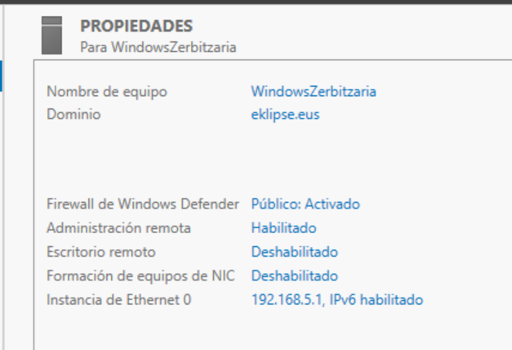

### 1.2 Domeinuaren egitura

Enpresa departamentuka antolatu da: `eklipse` OU nagusiaren barruan 3 OU daude, bakoitza departamentu bati dagokiona. Bakoitzak bere taldeak eta erabiltzaileak ditu, talde bakoitzak bi erabiltzaile. Horrela, GPOak eta baimenak departamentuka aplika daitezke.

| OU | Taldeak | Erabiltzaileak |
|---|---|---|
| Atoietako_Operazioak | DJ_Kontratazioa | Luken P. Pagaldai, Xabier G. Gayubas |
| Kudeaketa_Korporatiboa | Giza_Baliabideak, Marketina | Eneko T. Zengotita, Jakes D. Rio, Oinatz Goikoetxea, Urtzi X. Barrero |
| Sistemak_IT-Teknikariak | IT_Sistemak, Programatzaileak | Asier X. Larrañaga, Cristian J. Erique, Jokin Carrasco, Oier B. Erostarbe |

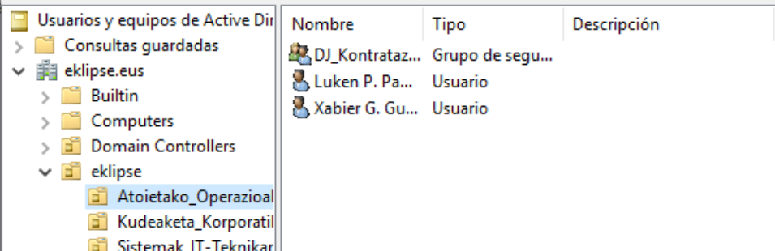

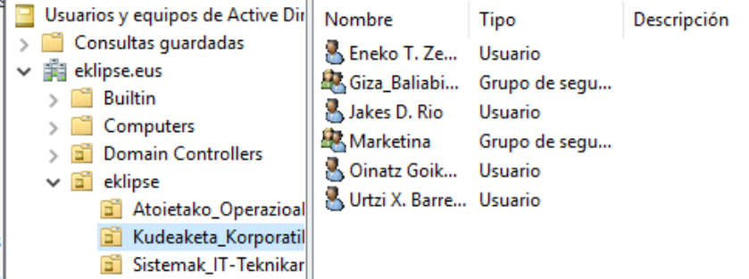

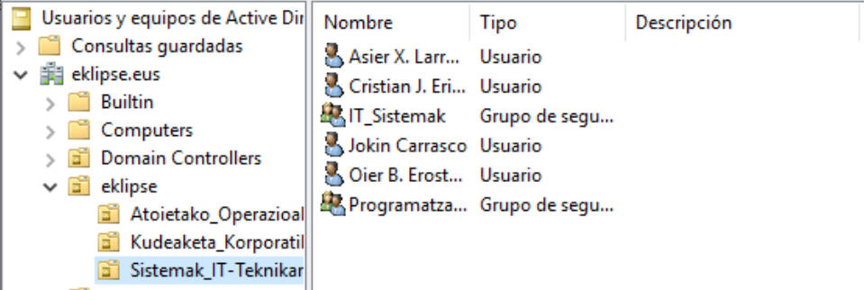

### 1.3 GPOak

| GPO | Non aplikatzen da | Zer egiten du |
|---|---|---|
| Bloqueo | `eklipse` (orokorra) | Pantaila-babesleak 600 segundora aktibatzen da |
| FondoDePantalla | `eklipse` (orokorra) | Enpresaren atzeko irudia jartzen du |
| GPO_Kontratazioa | Atoietako_Operazioak | Departamentuko GPOa |
| GPO_Kudeaketa | Kudeaketa_Korporatiboa | Departamentuko GPOa |
| GPO_OFICINA | Sistemak_IT-Teknikariak | Sareko bi unitate esleitzen ditu: `H:` eta `O:` |

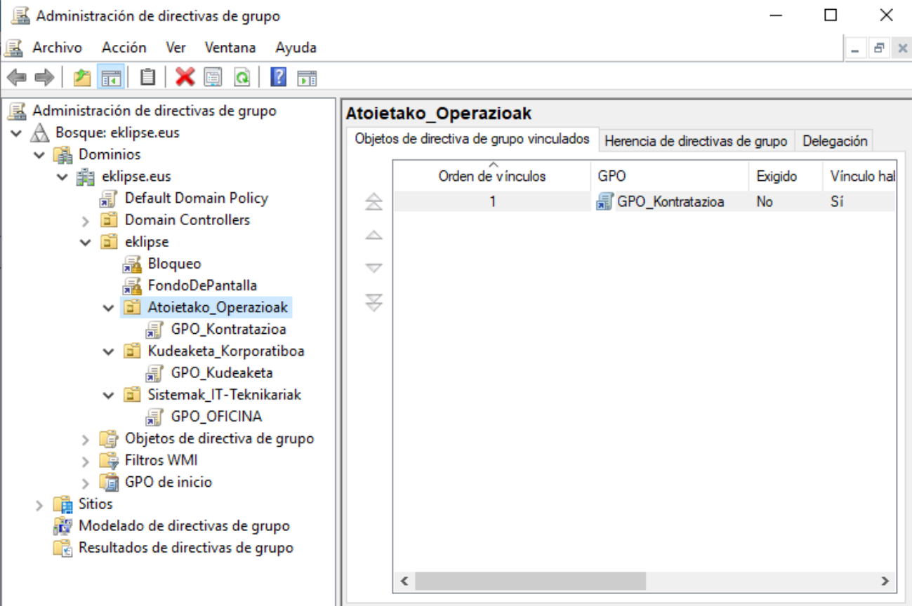

**Atzeko irudia:** domeinuko bezeroek Eklipse Nightclub-en irudia dute mahaigainean.

**Pantaila blokeatzea:** pantaila-babeslearen denbora-muga gaituta dago, 600 segundokoa.

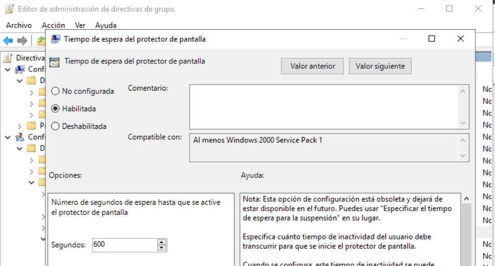

**Unitate esleipenak (GPO_OFICINA):** `H:` eta `O:` unitateak zerbitzariko partekatutako karpetetara lotuta daude.

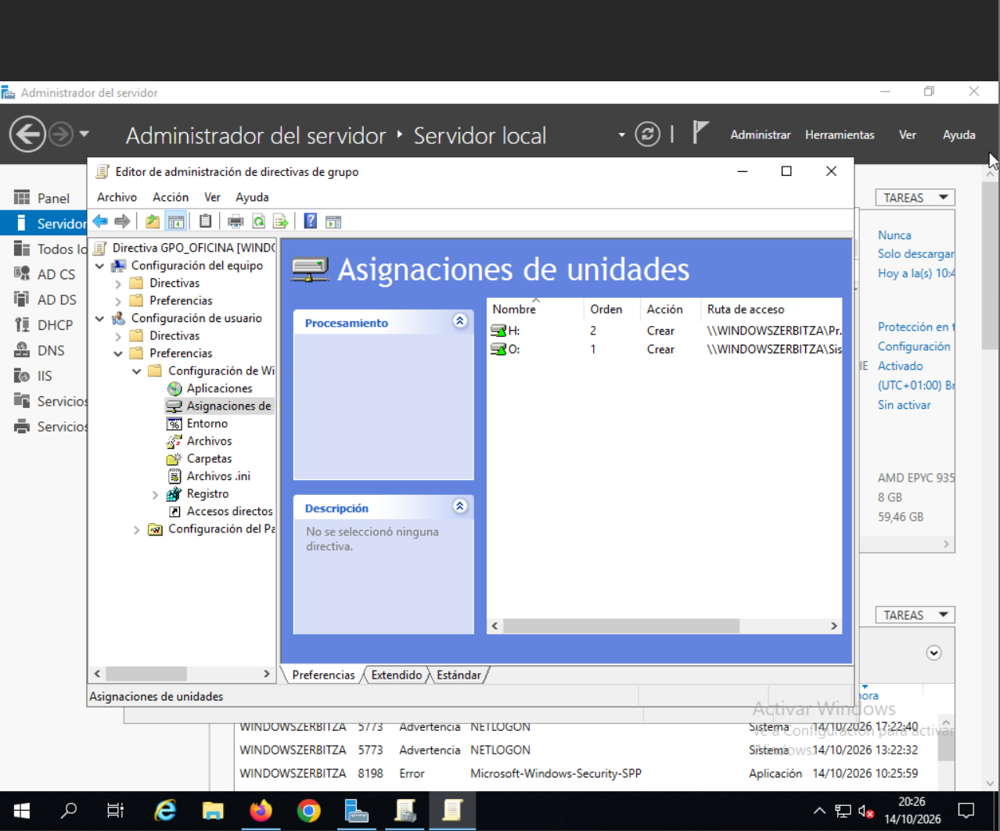

### 1.4 Bezeroaren integrazioa

Domeinuko bezeroak (`carrasco.jokin` erabiltzailea) DHCP zerbitzariaren bidez jasotzen ditu sare-parametroak, zerbitzariaren tarte berean:

| Parametroa | Balioa |
|---|---|
| IP helbidea | 192.168.5.105 (DHCP bidez) |
| Azpisare-maskara | 255.255.255.0 |
| Irteera-atea | 192.168.5.254 |
| DHCP zerbitzaria | 192.168.5.1 |
| DNS zerbitzaria | 192.168.5.1 (domeinuko zerbitzaria) |
| DNS atzizkia | eklipse.eus |

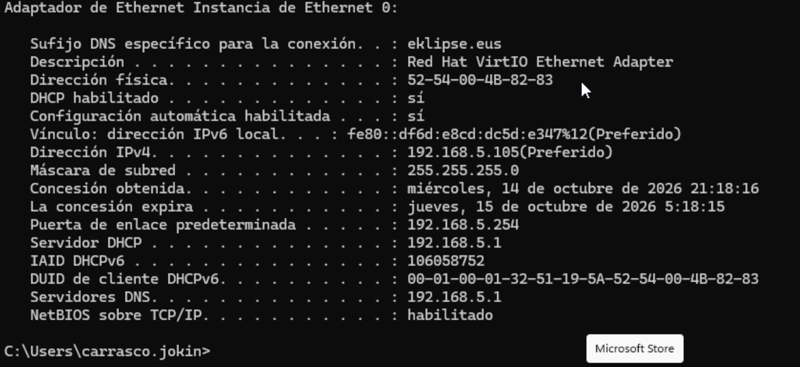

---

## 2. Inprimaketa-zerbitzariak

### 2.0 Inprimagailuak eta kokapena

| Inprimagailua | Sistema | Kokapena |
|---|---|---|
| WInprimagailua_Sistemas_IT | Windows Server | Sistemak IT departamentua |
| WInprimagailuak_RRHH | Windows Server | Giza Baliabideak (RRHH) departamentua |
| hp-bulegoa | Linux (CUPS) | Bulegoa (despatxua) |

### 2.1 Windows Server

Zerbitzariko inprimaketa rolarekin bi inprimagailu partekatu dira, bakoitza bere baimenekin:

- `WInprimagailua_Sistemas_IT`
- `WInprimagailuak_RRHH`

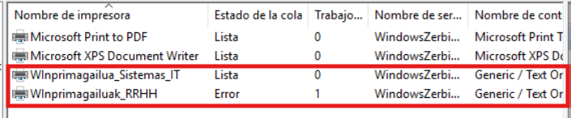

Baimenen froga: Cristian Erique Martinez `IT_Sistemak` taldekoa da, beraz `Sistemas_IT` inprimagailuan inprimatu dezake (dokumentua ilaran geratzen da).

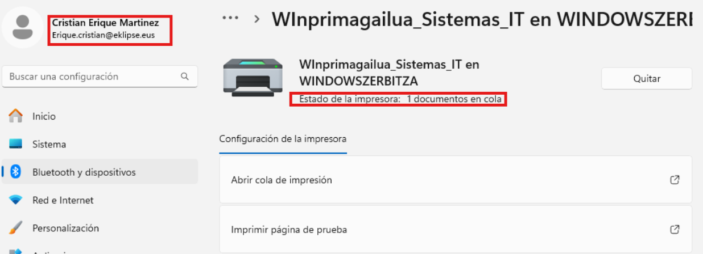

`RRHH` inprimagailuan, aldiz, sarbidea ukatuta du, ez baitago baimenduta.

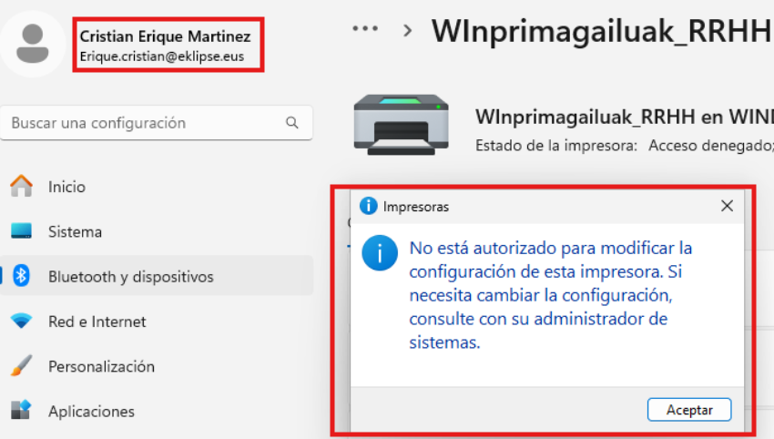

### 2.2 Linux (CUPS)

CUPS-ekin `hp-bulegoa` inprimagailua sortu eta partekatu da (HP DesignJet 4000 pcl, 2.0), `https://192.168.5.8:631` helbidean.

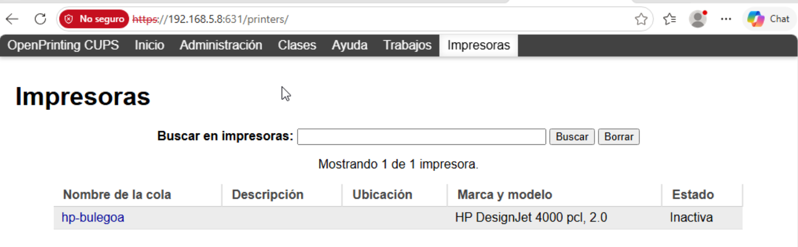

Linux ekipo batetik proba-orria inprimatu da, eta CUPS-ek lana osatuta bezala erregistratu du.

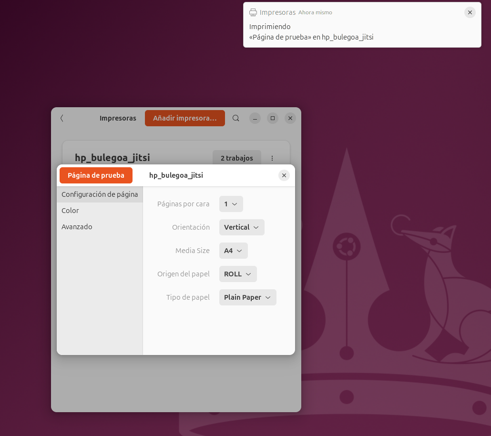

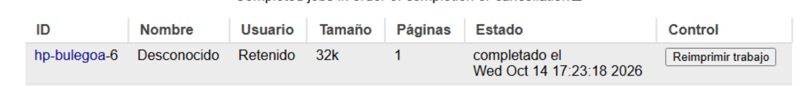

### 2.3 Sistema eragileen arteko partekatzea

**Windows → Linux:** Windows bezeroak CUPS inprimagailua (`hp-bulegoa @ jitsi`) ikusten du eta dokumentu bat dauka ilaran.

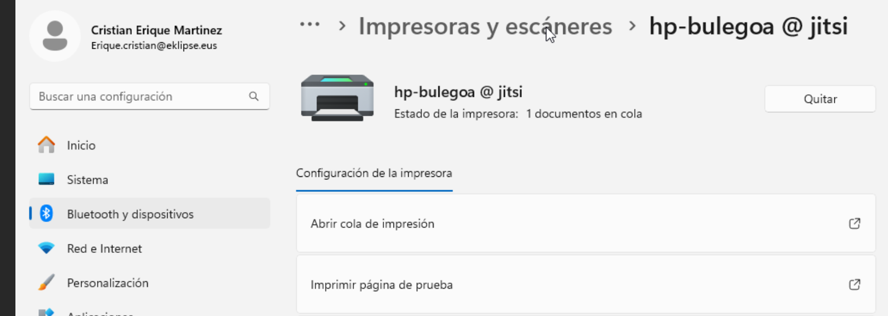

**Linux → Windows Server:** Linux ekipotik Windows Serverreko `WInprimagailua_Sistemas_IT` inprimagailuaren proba-orria atera da.

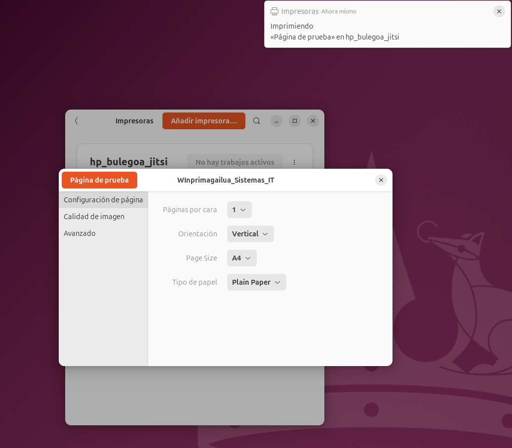
