# Sareko zerbitzuak eta Internet – Dokumentazioa

## 1. DNS

DNS zerbitzaria `WindowsZerbitzaria` makinan dago (192.168.5.1) eta `eklipse.eus` domeinuaren izenak ebazten ditu.

| Zona / elementua | Edukia |
|---|---|
| Zona zuzena | `eklipse.eus` |
| Zona alderantzizkoa | `5.168.192.in-addr.arpa` |
| Birbidaltzaile baldintzatua | `google` → 8.8.8.8 |

Zona zuzenean ostalarien erregistroak (A) daude:

| Izena | Mota | Datua |
|---|---|---|
| windowszerbitzaria | Host (A) | 192.168.5.1 |
| eklipse.eus (zona bera) | Host (A) | 192.168.5.1 |
| jitsi | Host (A) | 192.168.5.8 |

Zona alderantzizkoan `jitsi` ostalariaren erregistroa dago:

| IP | Mota | Datua |
|---|---|---|
| 192.168.5.8 | Puntero (PTR) | jitsi.eklipse.eus |

**Zona zuzena:**

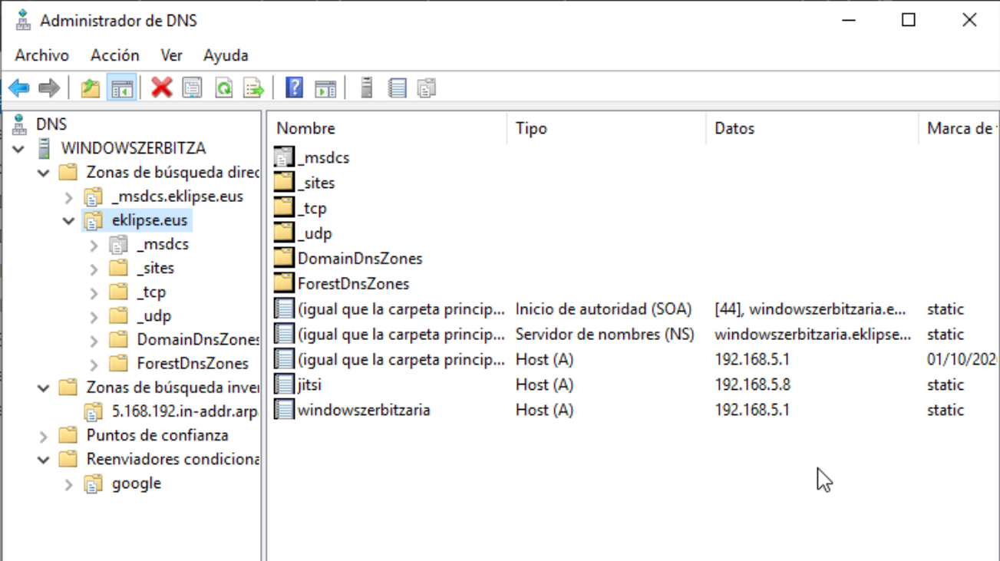

**Zona alderantzizkoa:**

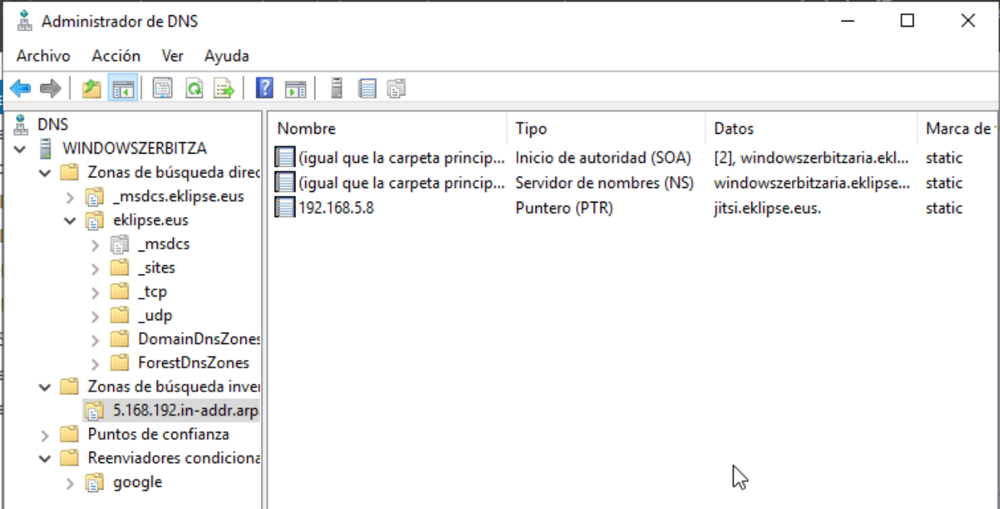

**Birbidaltzaile baldintzatua:**

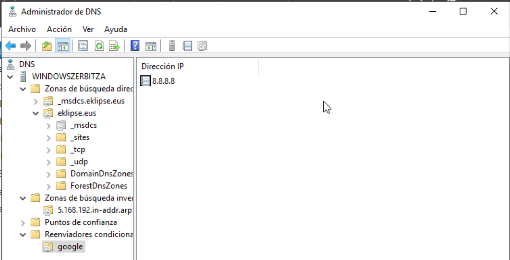

**Probak:** domeinuko bezero batetik `nslookup` bidez bi zonak ondo erantzuten dute. `jitsi.eklipse.eus` izenak 192.168.5.8 helbidea ematen du, eta 192.168.5.8 helbideak `jitsi.eklipse.eus` izena. Erantzuten duen zerbitzaria 192.168.5.1 da.

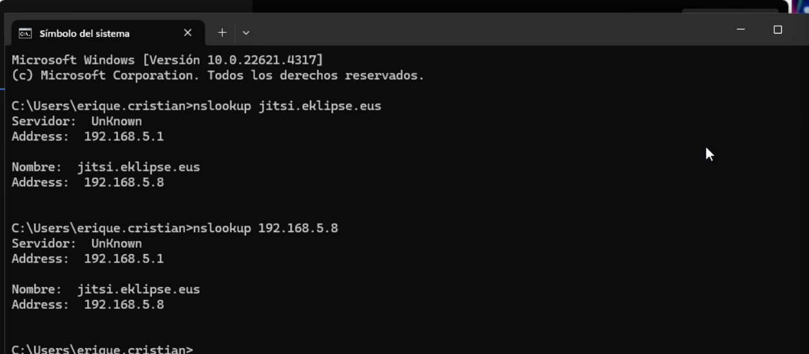

---

## 2. DHCP

DHCP zerbitzaria `WindowsZerbitzaria` makinan dago (192.168.5.1). `eklipse` izeneko ámbitoa sortu da 192.168.5.0 azpisarerako.

| Parametroa | Balioa |
|---|---|
| Ámbitoa | 192.168.5.0 (`eklipse`) |
| Banatzeko IP tartea | 192.168.5.100 – 192.168.5.150 |
| 003 Enrutadorea (irteera-atea) | 192.168.5.254 |
| 006 DNS zerbitzaria | 192.168.5.1 |
| 015 Domeinu-izena | eklipse.eus |

**Helbide-multzoa:**

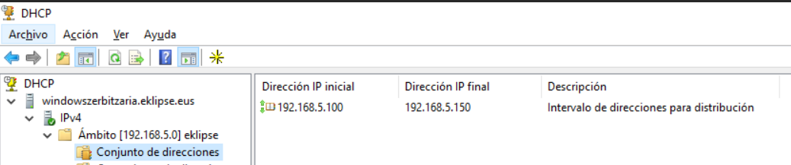

**Ámbitoaren aukerak** (irteera-atea, DNS eta domeinu-izena):

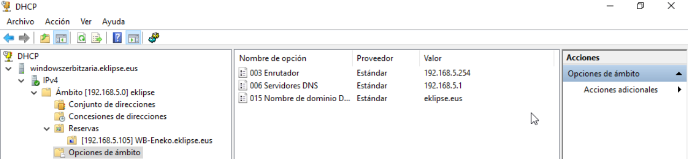

**Alokairuak:** bi bezerok jaso dute helbidea.

| IP | Bezeroa | Mota |
|---|---|---|
| 192.168.5.101 | Ubuntu-zerbitzaria | DHCP |
| 192.168.5.105 | WB-Eneko.eklipse.eus | Erreserba (aktiboa) |

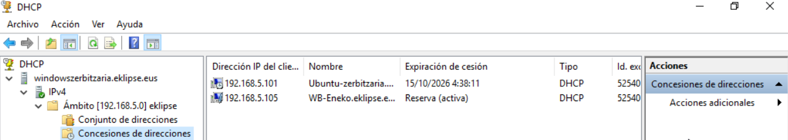

**Erreserba:** 192.168.5.105 helbidea `WB-Eneko.eklipse.eus` ekipoarentzat erreserbatuta dago.

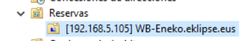

**Bezeroa:** domeinuko bezeroak 192.168.5.105 helbidea, 255.255.255.0 maskara, 192.168.5.254 irteera-atea eta 192.168.5.1 DNS zerbitzaria jasotzen ditu (DNS atzizkia: `eklipse.eus`).

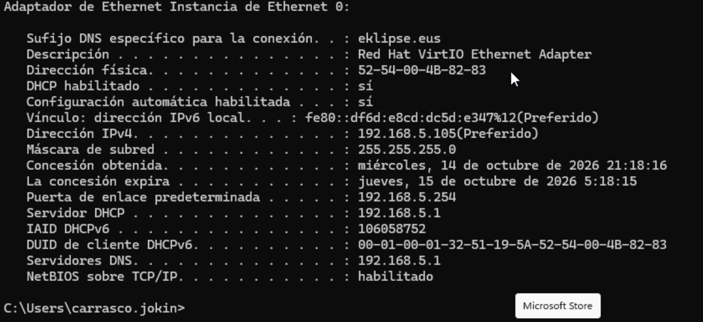

---

## 3. Jitsi (audio- eta bideo-zerbitzaria)

Jitsi Meet Linux zerbitzari batean dago instalatuta (`jitsi`, 192.168.5.8) eta `jitsi.eklipse.eus` izenarekin ebazten da, DNS zerbitzariaren A eta PTR erregistroei esker. Zerbitzu berak audioa eta bideoa kudeatzen ditu bileretan.

`jitsi-videobridge2` zerbitzua gaituta dago eta martxan (`active (running)`):

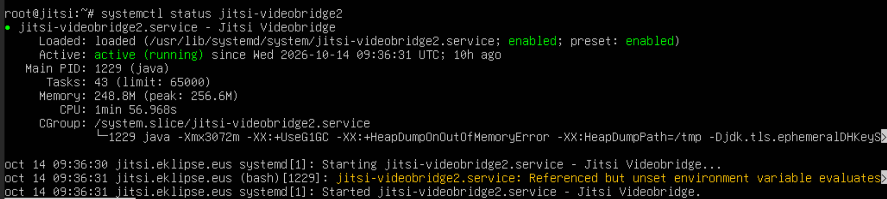

Bezeroak zerbitzura izenaren bidez sartzen dira (`https://jitsi.eklipse.eus`):

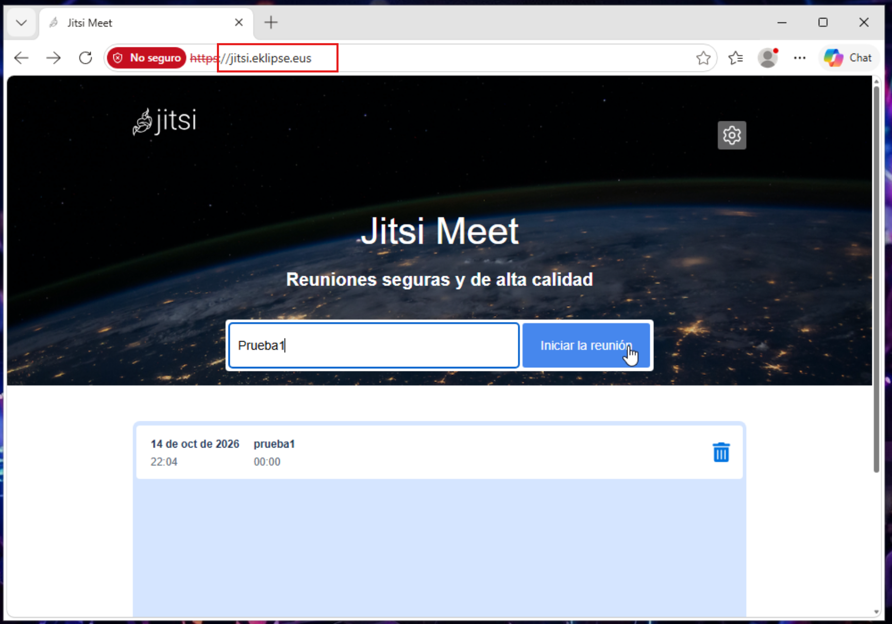

Proba gisa `Prueba1` bilera sortu da, bi partaiderekin (Jokin eta Joan) eta txata erabiliz:

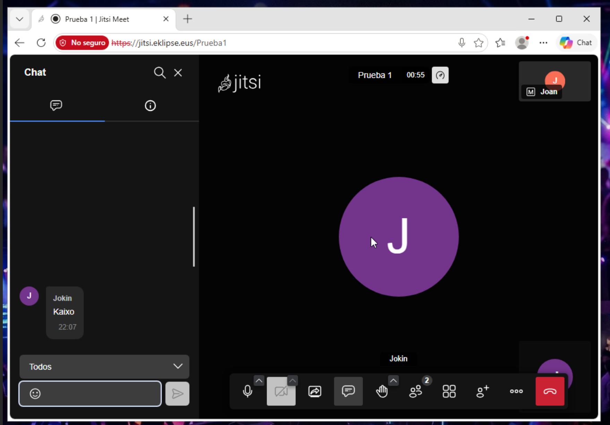
